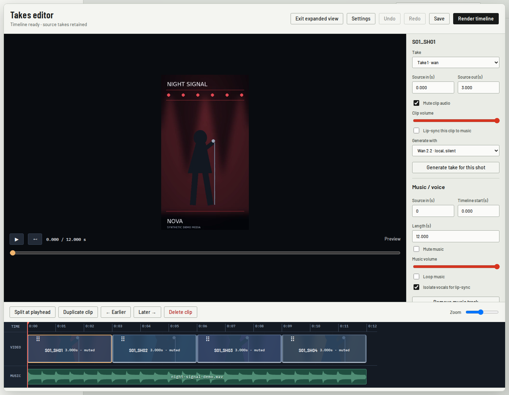
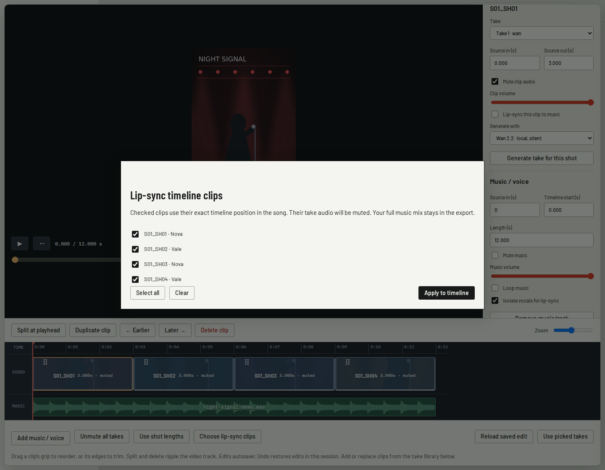
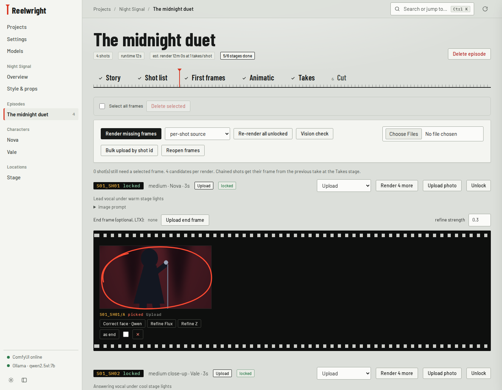
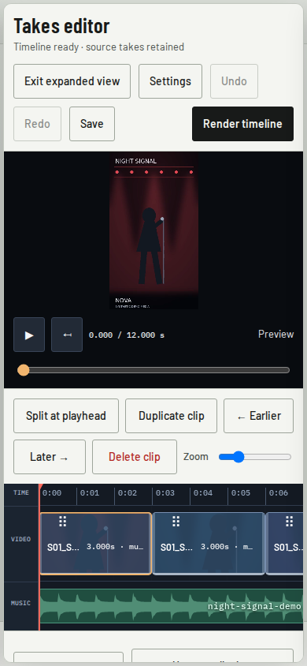

# Reelwright

**A local AI film and music-video studio with a built-in video editor.** Plan shots, keep character references, generate and correct takes, arrange the edit, add music, choose lip-sync clips and export an MP4 from Studio.



> **Current timeline build:** the editor shown here is on [`feat/takes-face-correction-and-models`](https://github.com/HakonHakon/Reelwright/tree/feat/takes-face-correction-and-models). The install commands below select that branch. `main` has the earlier Studio until the timeline changes are merged.

## What Studio handles

| Workspace | What you can do |
|---|---|
| **Projects & characters** | Create projects and episodes; save appearance, outfits, reference portraits, locations and style. |
| **Story & shot list** | Plan from a script, edit actions and timing, assign characters and models, split, merge and reorder shots. |
| **First frames** | Generate or upload candidates, crop photos on desktop or mobile, compare results and correct a face with Qwen Image Edit. |
| **Animatic** | Preview selected frames at shot length before generating video. |
| **Takes editor** | Generate takes, preview, reorder, trim, split, duplicate, delete, mute, mix music and choose lip-sync clips. |
| **Render & download** | Queue the saved timeline, follow progress in Activity, then watch or download versioned MP4 exports and an EDL. |

Local generation uses ComfyUI; story planning uses Ollama. The optional MiniMax Hailuo cloud provider requires a separate paid API account. Model weights and custom nodes must be installed for the workflows you select.

## Edit your film in Takes

Open an episode's **Takes** tab. Its timeline starts from the picked takes. Existing selected lip-sync finals with cut metadata open as segments of that final, preserving the approved picture.

1. **Arrange and preview.** Select a clip, scrub the playhead or press Play. Drag a clip's top grip to reorder it.
2. **Trim and split.** Drag either edge, or set **Source in / out** in Settings. Place the playhead inside the selected clip and choose **Split at playhead**.
3. **Keep the pieces you want.** Duplicate, move or delete clips. Deletion closes the gap and retains the source take. Undo/redo is available during the editing session.
4. **Control sound.** Mute individual clips or all takes, and adjust clip volume. **Add music / voice** creates a separate waveform track. Drag it to change its start, or set its source trim, length, volume, mute and looping in Settings.
5. **Generate another option.** Choose a video model and **Generate take for this shot**. Open **Take library & batch generation** to add a result or replace the selected clip. Replacing retains the edit length when the new source is long enough.
6. **Export.** Edits autosave. **Render timeline** queues a snapshot of the saved edit, checks the exported frame count, and makes the result available under **Rendered timelines** and in **Cut**.

This editor currently has **one ripple video track and one music track**. Music is trimmed to the end of the video. Overlays, transitions and multiple overlapping tracks are not implemented. Undo history lasts for the current session; saved edits survive reloads. Concurrent edits are checked by revision so another window cannot silently overwrite your timeline.

### Add vocals and lip-sync

After a music or voice upload, Studio asks whether to set up lip-sync. **Not now** keeps the upload as audio only; **Choose clips** opens the clip picker.



Select the single-character clips that should sing or speak. For a duet, choose the appropriate clips for both characters. Each clip uses the audio at its exact edited position in the song. Demucs can isolate vocals for guidance; the export keeps the full uploaded mix at your chosen music volume. Selected lip-sync clips have their take audio muted, which you can adjust in Settings.

**Render timeline** runs local LatentSync 1.6 through ComfyUI. Completed lip-sync clips are cached and reused when their source, trim, audio and model settings match. A failed or cancelled export leaves the previous final selected; re-submit after interruption to reuse completed clips. Jobs are held in memory, so a server restart requires submitting an unfinished job again.

Vocal isolation separates vocals from instruments, not one singer from another. Review the result, particularly for singing, profiles or covered mouths. Install the optional runtime using a Python 3.10 executable:

```sh
python scripts/install_lipsync.py --python /path/to/python3.10 --comfy /path/to/ComfyUI
```

Restart ComfyUI and Studio after installation. The installer creates an isolated runtime and downloads the lip-sync weights. See the [Studio guide on the timeline branch](https://github.com/HakonHakon/Reelwright/blob/feat/takes-face-correction-and-models/STUDIO.md) for configuration and the older Cut workflow.

## Characters, frames and face correction

Upload character portraits in the project's **Characters** pages, then assign those characters to shots. **First frames** supports uploaded images, reference-conditioned Qwen Image Edit, Flux with LoRAs and Z-Image. Review and pick candidates before generating takes.



- **Correct face · Qwen** adds a corrected frame candidate using the shot character's portrait.
- **Correct faces** in the take library can run Qwen Image Edit over every source frame and add a new take for comparison. This can take substantial GPU time.
- MiniMax H3 reference editing, KEEP and CodeFormer are additional configured correction options. They need their own weights or runtimes.

Identity correction currently requires a single-character shot. Generative edits can change expressions and details: compare candidates before selecting them. Source footage remains available.

## Video model selection

Select a model in the timeline inspector or in the take library's batch controls. The default option uses the shot/project setting.

| Studio model option | Where it runs | Take audio |
|---|---|---|
| **MiniMax H3** | Local ComfyUI, with the H3 weights and nodes configured | Generated audio |
| **LTX-2.3** | Local ComfyUI | Generated audio |
| **Wan 2.2** | Local ComfyUI | Silent |
| **MiniMax Hailuo** | Optional paid cloud API | Model dependent |

Installed filenames are configured in **Settings**. A model appearing in the selector does not mean its weights are installed. If Studio reports a missing file such as `flux1-dev.safetensors`, install the required model or change Settings to its actual installed filename.

## Install and run

The host PC needs Python 3.10+, ffmpeg/ffprobe, ComfyUI and the required models/custom nodes. GPU workflows target NVIDIA CUDA; development and local rendering have been tested on an RTX 3090 with 24 GB VRAM. Ollama supplies the configured story-planning model. The optional LatentSync runtime uses Python 3.10 separately.

### Windows

```bat
git clone --branch feat/takes-face-correction-and-models https://github.com/HakonHakon/Reelwright.git
cd Reelwright
setup.bat
start-studio.bat
```

### Linux

Install Python's venv support and ffmpeg/ffprobe, then:

```sh
git clone --branch feat/takes-face-correction-and-models https://github.com/HakonHakon/Reelwright.git
cd Reelwright
python3 -m venv .venv
.venv/bin/python -m pip install -r requirements.txt
bash start-studio.sh
```

Start ComfyUI and Ollama separately. Studio defaults to ComfyUI on port 8188 and Ollama on port 11434. Install the weights for your chosen workflows and check their filenames in Settings. The Linux launcher also recognizes a local ffmpeg installation under `.runtime/ffmpeg/`.

Already cloned? Save any local changes, then check out `feat/takes-face-correction-and-models` and pull its latest commits before starting Studio.

### Android, iPhone and iPad

Open `http://localhost:8020` on the PC. From a phone on the same network, use `http://<PC-LAN-IP>:8020`; the launchers listen on `0.0.0.0:8020`. The PC hosts the app and runs the models.

<p align="center">
  
</p>

Use **Expand editor** for a larger editing workspace and **Settings** to show the clip/music inspector. The timeline scrolls horizontally; grips and trim edges support touch dragging. Frame uploads support touch cropping and HEIC/HEIF photos.

**Install app** provides Android and iOS home-screen instructions. Installable web-app features require HTTPS with a certificate trusted by the phone; browser access works over LAN HTTP. To restrict Studio to the PC, change the launcher's host to `127.0.0.1`.

## Projects, deletion and backups

Use **Select all / Delete selected** on deletable collections, or **Delete project** on a project page. Project, episode and bible-entry folders are moved to hidden `.deleted_*` folders. Removing a frame or take detaches it while retaining its media file. Deleting a timeline clip changes only the edit.

Projects and media live under `studio_data/`. That directory, downloaded models and `.runtime/` are git-ignored. **A Git push backs up the code, not your characters, uploaded audio, projects or renders.** Back those directories up separately.

Activity shows queued/running jobs, logs and cancellation controls. Editing character descriptions or style marks dependent shots stale; it does not automatically regenerate them.

## Development checks

With pytest installed and ffmpeg/ffprobe on `PATH`:

```sh
python -m pytest tests/test_studio_features.py tests/test_lipsync.py tests/test_comfy_outputs.py tests/test_timeline.py -q
```

Browser checks additionally require Playwright, Chromium and WebKit:

```sh
python -m playwright install chromium webkit
python -m pytest tests/test_studio_mobile.py tests/test_timeline_browser.py -q
```

Tests use temporary projects and mocked model calls; media tests render actual FFmpeg outputs. The older full-pipeline tests also require the configured LTX template at `video_director_agent/i2v_template.json`.

The screenshots in this README were captured from the current Studio interface using an isolated **Night Signal** demo project with synthetic stage artwork and test audio. They demonstrate editing controls, not AI generation or lip-sync quality.

## Origins and license

Reelwright began as a fork of [KupkaProd Cinema Pipeline](https://github.com/Matticusnicholas/KupkaProd-Cinema-Pipeline). The original autonomous pipeline remains in `video_director_agent/`; see [its original README](docs/ORIGINAL-README.md).

The repository retains the original **non-commercial license** in [LICENSE](LICENSE). Bundled Barlow and IBM Plex Mono fonts use the SIL Open Font License; their licenses are in `studio/static/fonts/`. Individual model weights have their own licenses.
