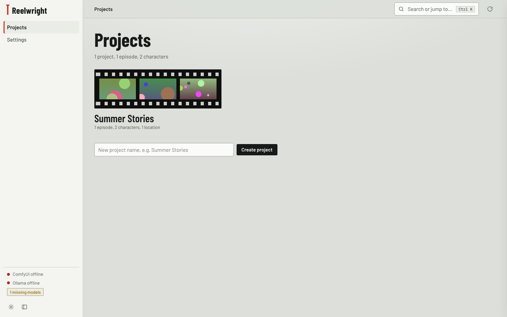
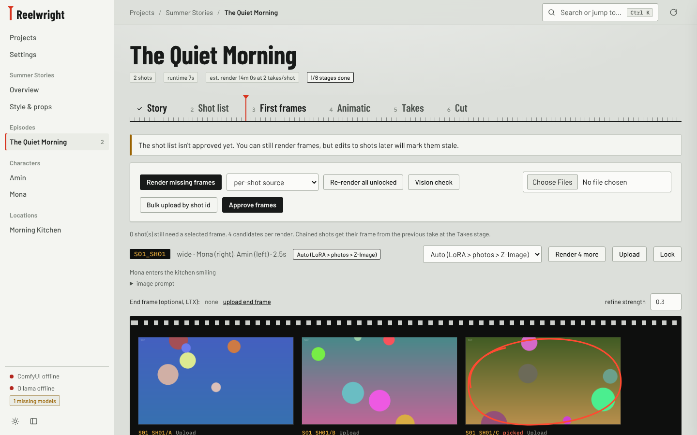
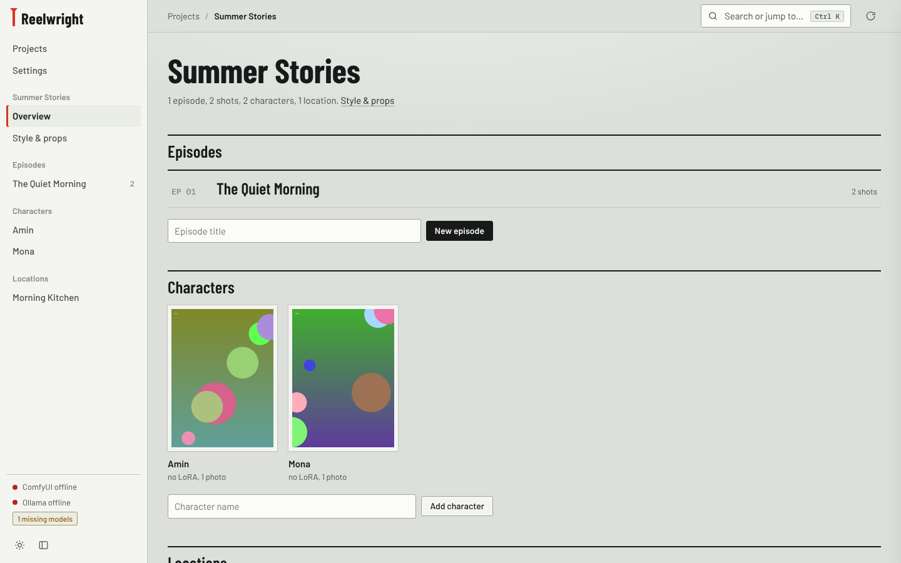
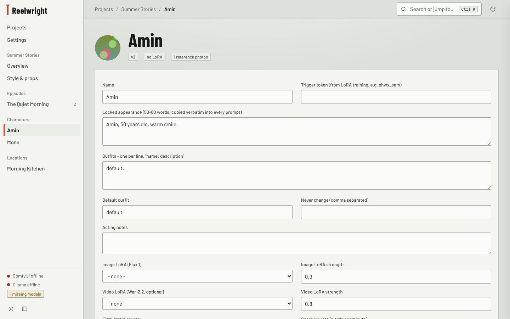
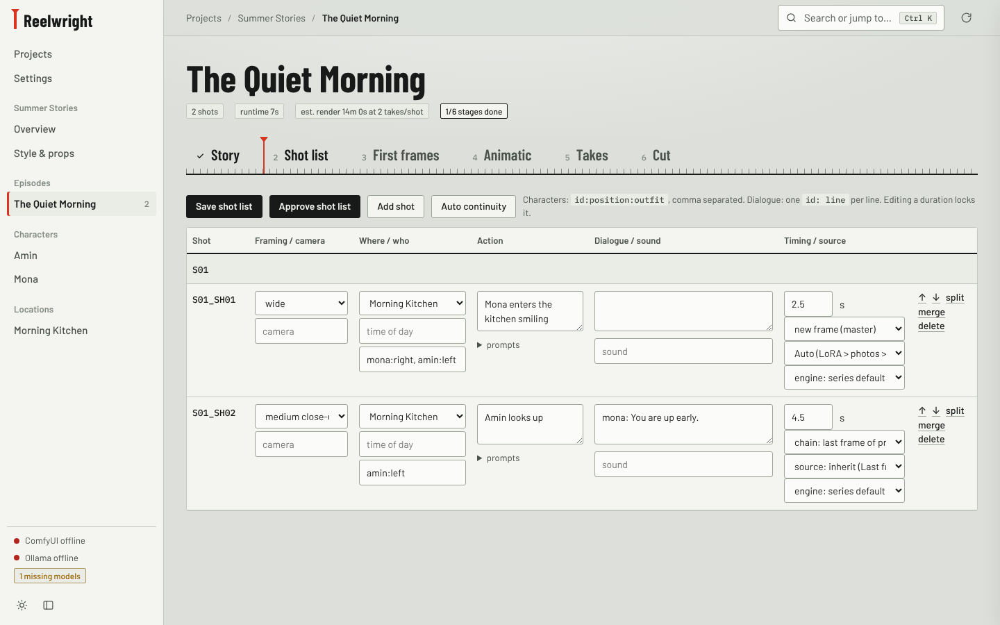

# Reelwright

A local studio for making short films and music videos with AI, one reviewed step at a time. Write a story, define your characters and locations, then work through the shot list, first frames, animatic, video takes and final cut. Local generation and lip-sync run on your PC through ComfyUI and Ollama, without paid API calls. Optional MiniMax Hailuo cloud models are available separately and require a paid API account.



## Why it exists

Reelwright keeps a **bible** (characters, locations, style) and carries those descriptions and references into each shot. Each stage has a review gate so you can compare candidates and approve them before spending more GPU time.

```
Story -> Shot list -> First frames -> Animatic -> Takes -> Cut
```



## Requirements

- Windows or Linux with an NVIDIA GPU (tested on an RTX 3090, 24 GB)
- [ComfyUI](https://www.comfy.org/) (Desktop or portable) on port 8188, with the models listed in **Settings**
- [Ollama](https://ollama.com/) for the story planner (the model is pulled automatically on first use)
- Python 3.10+ and ffmpeg

Phones and tablets access the studio running on your PC; Android and iOS do not run the GPU models themselves. Optional LatentSync 1.6 uses an isolated Python 3.10 environment and needs about 18 GB of VRAM.

Model names are configurable in **Settings**. The sidebar shows whether ComfyUI and Ollama are reachable and flags any missing model.

## Install and start

### Windows

```bat
git clone https://github.com/HakonHakon/Reelwright.git
cd Reelwright
setup.bat          :: once: creates .venv and installs dependencies
start-studio.bat   :: opens http://localhost:8020
```

### Linux

Install Python's venv support and ffmpeg on your system, then:

```sh
git clone https://github.com/HakonHakon/Reelwright.git
cd Reelwright
python3 -m venv .venv
.venv/bin/python -m pip install -r requirements.txt
bash start-studio.sh
```

Start ComfyUI and Ollama separately. The Linux launcher also supports a local ffmpeg installation under `.runtime/ffmpeg/` when one is present.

Both launchers listen on all interfaces (`0.0.0.0:8020`). Open `http://localhost:8020` on the PC, or `http://<PC-LAN-IP>:8020` from a phone on the same network. To restrict access to the PC, change `--host 0.0.0.0` to `--host 127.0.0.1` in the launcher.

The mobile interface supports touch cropping, photo uploads including HEIC/HEIF, and portrait video projects. Use **Install app** for Android and iPhone home-screen instructions. Installing the web app requires a secure connection: configure HTTPS and trust your local certificate on the phone. Ordinary browser access also works over LAN HTTP.

Your projects are saved in `studio_data/` next to the app. Project data, uploaded references, audio, renders, downloaded models and local runtimes are git-ignored. Back them up separately; pushing this repository does not upload them.

See [STUDIO.md](STUDIO.md) for model configuration and detailed workflow instructions. Model weights are not bundled with the repository; set their installed filenames in **Settings**.

## Quick tour: make an episode

The repo includes a short script, [`examples/the_rain_boat.txt`](examples/the_rain_boat.txt), to try the flow with.

### 1. Create a project and its bible

Create a project (one per show). Then open it:



- **Style & props**: look, colour grade, default first-frame source and video engine.
- **Characters**: appearance text (locked into every prompt), outfits, optional trigger word and image LoRA, an optional video LoRA, a voice sample, and reference photos.
- **Locations**: description, time-of-day variants, and an establishing plate.



Example character:

| Field | Value |
|---|---|
| Name | Sam |
| Appearance | small boy, about 5, round cheeks, messy brown hair |
| Outfit | teal raincoat with little yellow trees, red rubber boots |
| First-frame source | Reference photos (or Flux + LoRA if you trained one) |

### 2. Story

Paste a script or plain prose into **Story**. **Draft bible from story** creates draft characters and locations for you to review. **Plan scenes and shots** runs the planner, which may only use characters and locations that exist in the bible.

### 3. Shot list

Edit anything: framing, who is in the shot and where, action, dialogue, duration, first-frame source, video engine and start mode. Split, merge, reorder or add shots, then approve.



Character cells use `id:position:outfit`, comma separated, and dialogue is one `id: line` per line:

```
characters:  sam:left, mona:right
dialogue:    sam: Boat!
```

Start modes: **new frame**, **chain** (start from the last frame of the previous take) and **reuse** (share the previous frame).

### 4. First frames

Each shot gets several candidates on a film strip. Pick one (it gets the red ring), refine it with img2img, upload your own, or set an optional end frame. Lock shots you are happy with.

Frame sources:

| Source | Use it when |
|---|---|
| **Reference photos** (Qwen Image Edit) | You have photos of your character and no LoRA. Uses up to three reference images in total, including a location plate when supplied. |
| **Flux + LoRA** | You trained an image LoRA for the character. |
| **Z-Image** | Fast text-to-image, no character identity. |
| **Auto** | Uses a LoRA if the character has one, otherwise reference photos, otherwise Z-Image. |
| **Upload** | You made the frame elsewhere. Bulk upload works with files named `S01_SH02.png`. |

A vision check flags frames where the characters don't match their description.

**Correct face · Qwen** edits an existing candidate using the shot character's uploaded portrait. It adds a candidate for review and keeps the original. Character correction currently requires a single-character shot.

### 5. Animatic

Plays your picked frames at shot length with dialogue captions, so you can check pacing before spending GPU time. Export it as `animatic.mp4`.

### 6. Takes

Choose a video model for each render, or use the shot/project default:

| Engine | Processing | Audio |
|---|---|---|
| **MiniMax H3** | Local ComfyUI workflow, no paid API | Native generated audio |
| **LTX-2.3** | Local ComfyUI workflow | Generated audio |
| **Wan 2.2** | Local ComfyUI workflow | Silent |
| **MiniMax Hailuo** | Optional paid cloud API | Depends on the selected cloud model |

Render several takes, pick the best, trim it, and use **Last frame -> next shot** to continue a scene. Takes get quality flags for cuts or drift inside the clip.

**Correct faces** adds another take for comparison. Qwen Image Edit corrects every original frame from the character reference; MiniMax H3 offers a reference-conditioned video edit. KEEP and CodeFormer restore damaged faces when their separate runtimes are installed. Generative correction can change expressions or details, so review it before selecting it.

### 7. Cut

Optionally add a music bed that ducks under dialogue, then render `final.mp4` with `final.srt` subtitles and `final.edl` for DaVinci Resolve.

For a music video or a new voice recording, upload the audio and choose **Save music settings**. Studio asks whether to set up lip-sync:

1. Choose **Not now** to save the upload without running a model, or **Choose shots** to continue.
2. Select the character and the single-character shots that should sing or speak. Set the start time in the uploaded audio.
3. Leave vocal isolation on for a song, or turn it off for a clean voice recording.
4. Choose **Run lip-sync**, review the separate preview, then choose **Use as final** if you want to select it.

Local **LatentSync 1.6** changes mouth motion, with **Demucs** optionally isolating vocals for guidance. The export retains the full uploaded music mix at full volume, replacing the takes' audio. Original takes and the previous final remain available. Short audio is padded with silence and longer audio is trimmed to the cut; trim your takes to the intended song duration first. For a duet, select the appropriate shots for both characters; vocal isolation separates singing from instruments, not one singer from another.

Install the local lip-sync runtime using a Python 3.10 executable:

```sh
python scripts/install_lipsync.py --python /path/to/python3.10 --comfy /path/to/ComfyUI
```

Restart ComfyUI and Studio afterward. The installer downloads the required weights and keeps the model dependencies separate from ComfyUI's Python environment. The [ComfyUI API workflow](workflows/lipsync_latentsync_api.json) also runs outside Studio; see [the lip-sync setup guide](STUDIO.md#lip-sync-after-uploading-music) for details. Singing, profiles and microphones covering the mouth can reduce accuracy.

## Selection and deletion

Use **Select all** and **Delete selected** on deletable collections, including projects, episodes, character references, shot rows, frame candidates and takes. Save the shot list to apply staged shot deletion. Project, episode and bible-entry folders move to hidden `.deleted_*` folders for recovery; removing a frame or take detaches it while retaining its file on disk.

## Tips

- Press **Ctrl K** to search and jump anywhere. The activity button (top right) shows running jobs and logs.
- Jobs run one at a time on the GPU. Ollama is unloaded before renders.
- Editing a character, location or style marks the shots that depend on it as **stale**. Nothing re-renders automatically.
- Project data is plain JSON plus media files, so you can edit it by hand.

## Tests

Install `pytest` in the studio environment and ensure ffmpeg and ffprobe are on `PATH`. Run the API, media and model-routing checks with:

```sh
python -m pytest tests/test_studio_features.py tests/test_lipsync.py tests/test_comfy_outputs.py -q
```

Mobile browser checks additionally need Playwright with Chromium and WebKit installed:

```sh
python -m pytest tests/test_studio_mobile.py -q
```

These tests use temporary projects and mocked GPU calls. The full pipeline tests in `tests/test_studio_e2e.py` also require the configured LTX template (`video_director_agent/i2v_template.json` by default). The screenshots above come from a throwaway demo project with generated placeholder images.

## Origins and license

Reelwright started as a fork of [KupkaProd Cinema Pipeline](https://github.com/Matticusnicholas/KupkaProd-Cinema-Pipeline) by Matt Kupka. The original autonomous pipeline is still in `video_director_agent/` (see [docs/ORIGINAL-README.md](docs/ORIGINAL-README.md)); the studio in `studio/` is the new interactive app.

The code is distributed under the original **non-commercial license**: see [LICENSE](LICENSE). Bundled fonts (Barlow, IBM Plex Mono) are under the SIL Open Font License; their licenses are in `studio/static/fonts/`.
